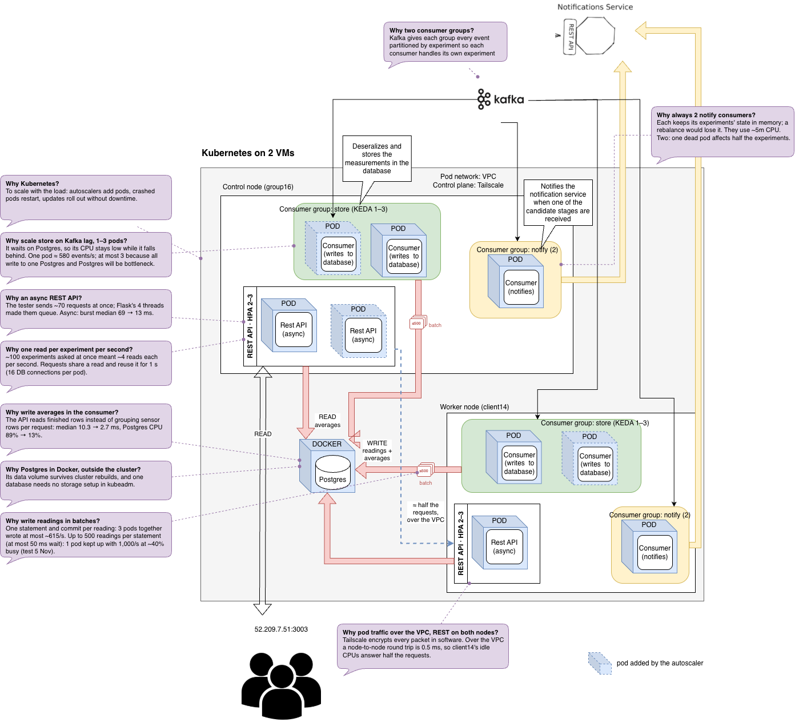

# cloud-edge-computing-project



On group16, from the repo root, with `.env` and `auth/` present:

    make start    
    make stop
    make status

##archiecture

- consumer/README.md: store-consumer and notify-consumer (Rust)
- rest-api/Readme.md: REST API (Python, granian)
- database/README.md: schema
- k8s/README.md: manifests, cluster setup, building and pushing images
- k8s/monitoring/: Prometheus, Grafana and the exporters; dashboards in k8s/monitoring/grafana/dashboards/
- scripts/: benchmark, retention cleanup, Kafka offset reset

## Data retention

Run every day at 3

```sh
(sudo crontab -l 2>/dev/null; \
  echo "0 3 * * * $(pwd)/scripts/cleanup-retention.sh >> /var/log/cleanup-retention.log 2>&1") \
  | sudo crontab -
```

 To check the existing cronjobs:

```sh
sudo crontab -l
```
