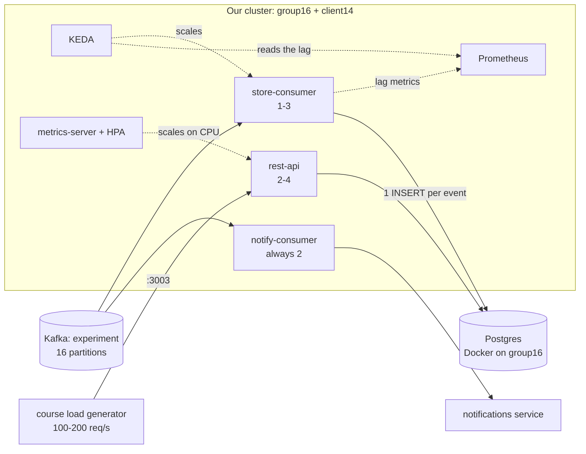

# Implementation plan: consumers and scaling (2026-10-31)

> Written against `feat/kubernetes`; values marked "was" refer to that branch. On this branch the plan is applied one step per commit, starting from the fixed 4/2/2 setup.

**Scope:** issue #14 and the assignment's requirement *"scale based on the system's load"*. The plan covers how many consumer and REST pods run, when they scale, and that they never overload the two VMs.

**Out of scope:**
- monitoring: Prometheus, Grafana and the exporters stay as they are and are extended separately. KEDA reads the store-consumer's lag from Prometheus.
- REST API code
- Postgres

Where this plan and `SCALING-REVIEW.md` disagree, this plan wins.

## Target

At the course's default load, nothing scales: 2 notify-consumer, 1 store-consumer, 2 rest-api.

## Which pods scale, and why

A component autoscales only if all three hold:
1. It holds no state of its own.
2. One pod has a limit of its own.
3. The demo can push it past that limit.

| Component | Pods | Scales when | Reason (measured) |
|---|---|---|---|
| notify-consumer | **always 2** | never | It keeps experiment state in memory, and every rebalance would lose it. It uses ~5m CPU. 2, not 1, so one dead pod only affects half the experiments. |
| store-consumer | **1-3** | Kafka lag > **3000 per pod** | It holds no state. One pod writes one event per DB round trip (1.7 ms), so it handles **~500-580 events/s**. The course load is ~200 events/s, but the demo load is unknown. Max 3 because all pods write into one Postgres. |
| rest-api | **2-4** | CPU > **500m per pod** | It holds no state. One pod handles **200 req/s at 37% CPU** (30-50 ms). With 500m per pod it scales only above ~540 req/s. The old target (60% of 200m) went to 4 pods even at 200 req/s. 2 so a restart never shows as errors. |

## Memory: request = limit

With request = limit, the scheduler can't promise more memory than a node has. A pod that doesn't fit waits as `Pending`, and the node never runs out. No CPU limits, because they throttle and add latency.

| Pod | Measured | Memory (request = limit) | Max pods | Max total |
|---|---|---|---|---|
| rest-api | 126-132 MiB | 192Mi (was 160/384) | 4 | 768 MiB |
| notify-consumer | 9-17 MiB, 144 MiB worst replay | 192Mi (was 64/256) | 2 | 384 MiB |
| store-consumer | 6 MiB | 96Mi (was 64/192) | 3 | 288 MiB |
| **All at maximum** | | | | **1,440 MiB** |

That leaves room on both nodes:

| | group16 | client14 |
|---|---|---|
| RAM | 3.8 GiB | 1.9 GiB |
| Reserved by `reserve-node.sh` (OS, plus Postgres on group16) | 1 GiB | 512 MiB |
| System pods (control plane, DNS, network, KEDA, metrics-server) | ~0.4-0.6 GiB | ~0.25-0.55 GiB |
| **Left for our pods** | **~2.1 GiB** | **~0.75-1 GiB** |

The monitoring pods (Prometheus, Grafana, exporters: ~280 MiB measured) still fit next to that.

## Steps

### 0. On the VMs (you)

- [ ] `kubectl delete node ip-10-0-1-72`. The node is dead, and its pods block `make stop`.
- [ ] Bring client14's disk below 70% (it's 81-84%; kubelet evicts pods below 15% free):
  - `sudo rm /swapfile-build`
  - `docker builder prune -af`
- [ ] `git pull` on group16, then run `sudo scripts/reserve-node.sh` on both nodes.
- [ ] During the demo, don't run development sessions or Docker builds on client14.

### 1. Scale on load (manifests)

- [x] `k8s/store-consumer-scaledobject.yaml`: 1-3 pods; KEDA's Prometheus trigger on the backlog query of the dashboard's "Backlog (lag)" panel, threshold 3000 (~5 s of one pod's work)
- [x] `k8s/rest-api-hpa.yaml`: 2-4 pods, target `type: AverageValue`, `averageValue: 500m`
- [x] no `replicas` in either Deployment; rest-api's spread is `ScheduleAnyway`, so a NotReady node doesn't keep extra pods Pending
- [x] README: autoscaler install and the reasons for each count; Makefile carried over from `feat/kubernetes`

### 2. store-consumer never skips an event (small code change)

Today, if Postgres fails or restarts, the event is logged and skipped for good, because its offset was already stored when it was read. The DB client also never reconnects.

- [ ] `consumer/src/kafka.rs`:
  - set `enable.auto.offset.store=false`
  - `handle` returns a `Result`
  - on `Ok`, call `store_offset_from_message(&message)`
  - on `Err`, return the error: the process exits, Kubernetes restarts the pod with a new DB connection, and it continues from the last committed offset
- [ ] `store.rs`: return the `db.execute` error instead of only logging it, and remove the per-event `println!`. At 500 events/s that line alone writes 500 log lines/s on the nodes.
- [ ] `notify-consumer/main.rs`: the handler returns `Ok(())`, so it behaves as today.
- [ ] Build and push both images.

Replays are safe: the inserts use `ON CONFLICT DO NOTHING`, and the other events are updates.

### 3. Memory (manifests)

- [ ] Set memory request = limit as in the table:
  - `store-consumer.yaml`: 96Mi
  - `notify-consumer.yaml`: 192Mi
  - `rest-api.yaml`: 192Mi

  CPU requests as on `feat/kubernetes`.

### 4. Verify

Use the course Grafana (`grafana.cec.dlandau.nl`, *group_personal*) for notification latency and REST errors, and `make watch` for the pod counts.

| Test | How | Pass |
|---|---|---|
| KEDA reads the lag | `kubectl -n cec get scaledobject store-consumer`; `kubectl -n cec get hpa keda-hpa-store-consumer` | READY True; the HPA shows a lag value, not `<unknown>` |
| HTTP at the course rate | `docker run --rm williamyeh/hey -z 60s -c 50 -q 4 "http://52.209.7.51:3003/temperature/out-of-range?experiment-id=<id>"` (50 × 4 = 200 req/s) | 0 errors, **rest-api stays at 2** |
| HTTP overload | `make stress-rest DURATION=120s` | at most 4 pods, nodes `Ready` |
| Kafka load one pod handles | `make stress-kafka PROFILE=const-500 STRESS_LAG=3000` | **store-consumer stays at 1**, lag back to 0 |
| Kafka load above one pod | `make stress-kafka PROFILE=const-1000 STRESS_LAG=3000` | grows to 2-3, lag back to 0, back to 1 later |
| Postgres restart | `docker restart postgres` on group16 while live | store-consumer restarts, lag back to 0, no gap in the stored data |
| Notifications | course Grafana, *# Notifications > 10s* | 0 |
| Nothing overloaded | `kubectl get events -A \| grep -E 'OOM\|Evict'`, `kubectl top nodes`, `df -h /` | no events, > 300 MiB free per node, disk < 75% |

## Deliberately not done

| | Why not |
|---|---|
| Batched inserts in store-consumer | One pod already handles ~2.5x the course load, and scaling covers the rest. Batching (18x faster) would make store-consumer scaling pointless, so it's kept in reserve in case the Kafka test shows Postgres can't keep up with 3 pods. |
| Autoscaling notify-consumer | It would lose experiment state on every rebalance, and it uses ~5m CPU |
| REST API code, Postgres replicas, more nodes, CPU limits | Not ours / too much complexity / throttling adds latency |

## Risks left

- **group16 is a single point of failure:** it runs the control plane and Postgres.
- **A dying notify-consumer pod** loses the state of its experiments; those get no notifications until they're configured again.
- **Postgres down for minutes:** the store-consumer crash-loops with growing waits, up to 5 min. Kafka keeps the events, so it catches up once it restarts.
- **KEDA depends on Prometheus:** if Prometheus is down, store-consumer keeps its current pod count.
- **Capacity:** covered up to ~1,000 req/s (4 rest-api pods) and ~1,500 events/s (3 store-consumers, to be confirmed by the `const-1000` test). Above that, requests queue and lag grows, but nothing crashes.
